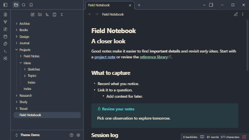

# Soft Slate Dark

A medium charcoal Obsidian theme with warm text and clearly separated panels.

Source version 3.7.2. The theme supports dark mode and requires Obsidian 1.15.1 or later. The original release was tested in Obsidian 1.15.1 on Windows.

## Preview

## Install manually

1. Download `manifest.json` and `theme.css` from the [latest published release](https://github.com/tutivsoft-com/obsidian-theme-soft-slate-dark/releases/latest).
2. Put both files in `.obsidian/themes/Soft Slate Dark/` in your vault.
3. Open **Settings > Appearance**, select **Soft Slate Dark**, and set the base colour scheme to **Dark**.

See the [original design plan](PLAN.md). [MIT license](LICENSE).

See the [desktop UI test report and screenshots](docs/ui-testing/2026-11-24/README.md).

## Check the source

With Python, `tinycss2` and `cssselect2` installed, run `python -B -m unittest discover -s tests`.
